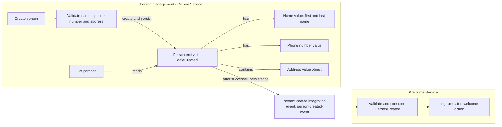
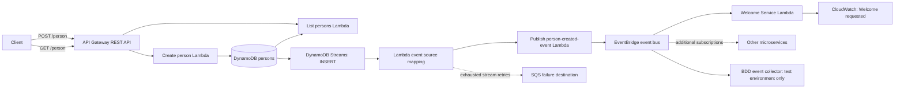

# Person Service

A serverless Person microservice built with AWS CDK and TypeScript. It creates persons, lists existing persons, and publishes `person-created-event` to a dedicated EventBridge bus. A minimal Welcome Service consumes that event and logs a simulated welcome action.

## Domain model and service boundaries

This domain-oriented view shows the current model and service responsibilities. Domain rules are implemented with Zod schemas




## Architecture



EventBridge remains the integration boundary between microservices. 


## Requirements and installation

Use Node.js 24 (`nvm use`), npm, AWS credentials and a CDK-bootstrapped account/region.

```bash
npm ci
npm run type-check
npm run lint
npm test -- --runInBand
npm run build
```

## Deploy independently to dev and production

Use environment credentials from a dedicated IAM user. The CDK app does not hard-code an account or deployment region.

To deploy with access keys stored locally in `.env`, copy `.env.example` to `.env` in the project root (`cp .env.example .env`) and replace the placeholder values with your AWS credentials and region:

```dotenv
AWS_ACCESS_KEY_ID=your-access-key-id
AWS_SECRET_ACCESS_KEY=your-secret-access-key
AWS_REGION=eu-west-1
```

`AWS_ACCESS_KEY_ID` and `AWS_SECRET_ACCESS_KEY` provide credentials for this setup; `AWS_REGION` selects the deployment region.

The AWS CLI and CDK do not automatically load `.env` files. From the project root, load and export the variables in your current shell before running deployment or BDD commands

```bash
set -a
source .env
set +a
```
Repeat this in each new terminal or after changing `.env`.

```bash
# Once per target account/region, if not already bootstrapped:
npm run cdk -- bootstrap

npm run synth:dev
npm run deploy:dev
npm run deploy:prod
```

## API

After deployment, CDK prints `PersonApiUrl` in the stack outputs. This is the full URL for both `GET` and `POST /person`, for example:


### Create: POST /person

```json
{
  "firstName": "Ada",
  "lastName": "Lovelace",
  "phoneNumber": "+31612345678",
  "address": {
    "street": "Example Street",
    "houseNumber": "10A",
    "postalCode": "1011AB",
    "city": "Amsterdam",
    "country": "Netherlands"
  }
}
```

All fields are required.

### List: GET /person

Returns at most `MAX_PAGE_SIZE` persons per request (default: **5**). 

Use `GET /person?limit=5` 


## BDD integration tests

```bash
npm run bdd:deploy:dev
npm run bdd:dev
npm run bdd -- --dry-run
```

## Cleanup and assessment scope

```bash
# Delete all application and BDD stacks for this stage
npm run destroy:dev

# Or delete only one set of stacks
npm run app:destroy:dev
npm run bdd:destroy:dev
```

All environments, including `prod`, are disposable: destroy deletes the selected stacks and their DynamoDB tables and data

